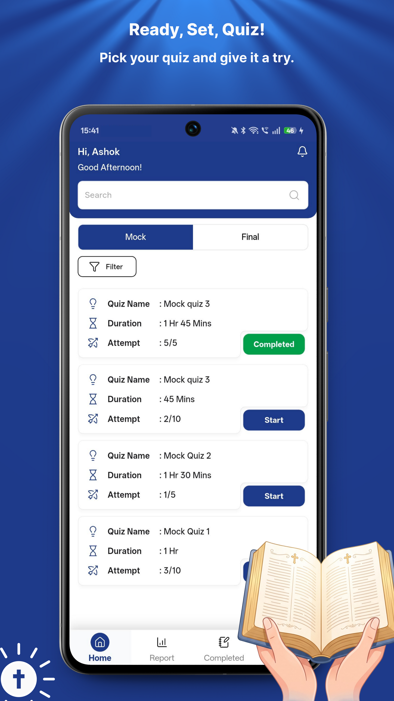
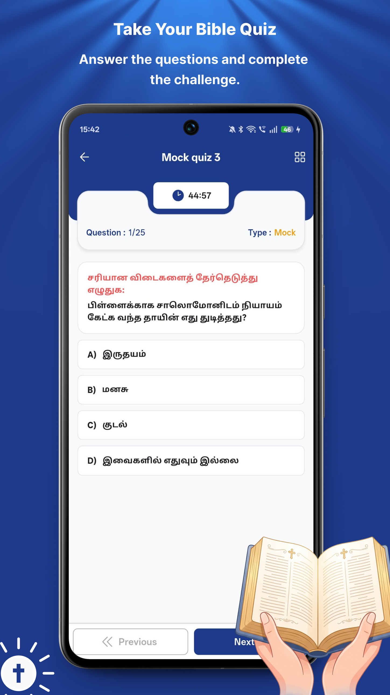
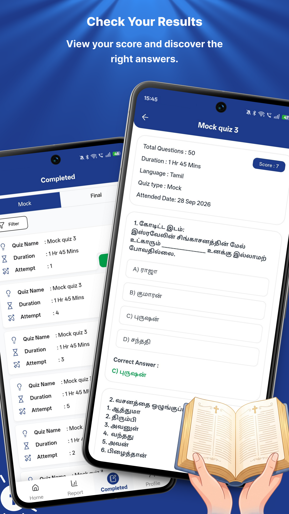
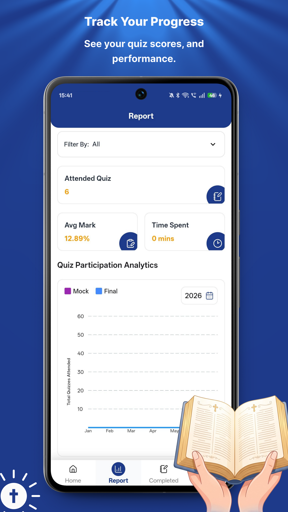

# 📖 Bible Quiz App — Interactive Mobile Application Case Study

<p align="center">
  
  
  
  
  
  
</p>

---

## 📌 Project Overview

The **Bible Quiz App** is an interactive, gamified mobile application engineered to test and deepen biblical knowledge through timed quizzes, structured topic categories, answer reviews, and comprehensive analytics.

The application delivers an engaging, competitive, and educational mobile experience:
- **Scheduled & On-Demand Quizzes**: Dual-tab quiz catalog supporting scheduled live mock/final exams and self-paced practice.
- **Timed Question Engine**: Real-time countdown timer with question progress tracking and smooth option selection.
- **In-Depth Results & Answer Key**: Immediate score evaluation with review keys to reinforce learning.
- **Performance Analytics**: Historical statistics and performance trends to monitor knowledge retention.

---

## 📱 Application Screenshots & Interface Tour

<div align="center">
  <table>
    <tr>
      <td width="25%" align="center">
        
        <br /><b>Quiz Catalog & Scheduled Exams</b>
      </td>
      <td width="25%" align="center">
        
        <br /><b>Countdown Timer & Questions</b>
      </td>
      <td width="25%" align="center">
        
        <br /><b>Results Review & Answer Key</b>
      </td>
      <td width="25%" align="center">
        
        <br /><b>Quiz Analytics & Trend Report</b>
      </td>
    </tr>
  </table>
</div>

---

## 👨‍💻 My Role & Key Contributions

**Flutter Developer**

Contributed to the end-to-end frontend development and interactive quiz engine implementation using Flutter and Dart:

### 1. Interactive Timed Quiz Experience
- Built clean, responsive multiple-choice question interfaces with tap-state feedback, instant visual validation, and smooth question transitions.
- Integrated high-precision countdown timers that automatically advance or submit quizzes when time expires.

### 2. Scheduled Quiz Availability & Cataloging
- Engineered the quiz catalog supporting **Mock Test** and **Final Exam** categorization.
- Implemented time-gated quiz unlock mechanisms that control when participants can begin scheduled quizzes.

### 3. Results Review & Comprehensive Answer Key
- Built post-quiz review screens highlighting correct, incorrect, and skipped responses.
- Implemented scripture reference popups and explanatory answer sheets to promote deeper understanding.

### 4. Performance Analytics & Progress Tracking
- Implemented visual analytics dashboards displaying total attempts, average accuracy percentages, time-per-question metrics, and historical performance trends.

---

## 🛠️ Technical Focus & Architecture

```
┌────────────────────────────────────────────────────────┐
│                   Flutter Presentation                  │
│       (Material 3, Timed Quiz UI, Score Charts)        │
└───────────────────────────┬────────────────────────────┘
                            │
┌───────────────────────────▼────────────────────────────┐
│                  Riverpod State Management             │
│    (QuizNotifier, TimerProvider, ScoreStateNotifier)   │
└─────────────┬───────────────────────────┬──────────────┘
              │                           │
┌─────────────▼──────────────┐ ┌──────────▼──────────────┐
│        Timer Controller    │ │      Local Persistence  │
│   (Precision Ticker Stream,│ │  (Local Notifications,  │
│    auto-submission listener│ │   SQLite History/Cache) │
└────────────────────────────┘ └─────────────────────────┘
```

- **Framework**: Flutter & Dart
- **State Management**: Riverpod (`StateNotifierProvider`) for managing active question indices, option selections, and remaining time
- **Timer Mechanics**: Dart asynchronous ticker streams synchronized with application lifecycle states
- **Local Persistence**: Local caching of completed attempts, score history, and question banks
- **Notifications**: Scheduled reminder alerts for upcoming live quizzes

---

## 💡 Key Learnings & Engineering Outcomes

- **High-Stakes Timer Management**: Ensuring timer accuracy during app backgrounding, screen orientation switches, and interruption states.
- **State Isolation in Dynamic Quizzes**: Designing modular question-and-answer state controllers that easily handle randomized question orders and variable question types.
- **Gamified Educational UX**: Balancing urgency (countdown timers) with clean legibility and satisfying feedback micro-interactions.

---

## 🔒 Project Privacy Notice

This repository documents my professional mobile engineering contributions. It does not include proprietary quiz content, private question banks, backend endpoints, credentials, or user data.

---

## 📬 Contact & Portfolio

**Kabilan R** — Flutter & Mobile Application Developer  
- **🌐 Portfolio**: [https://kabilan-portfolio.vercel.app](https://kabilan-portfolio.vercel.app)  
- **🐙 GitHub**: [@KabilanR-Dev](https://github.com/KabilanR-Dev)  
- **💼 LinkedIn**: [linkedin.com/in/kabilan-r-91432b268](https://www.linkedin.com/in/kabilan-r-91432b268)  
- **📧 Email**: [kabilanr244@gmail.com](mailto:kabilanr244@gmail.com)
